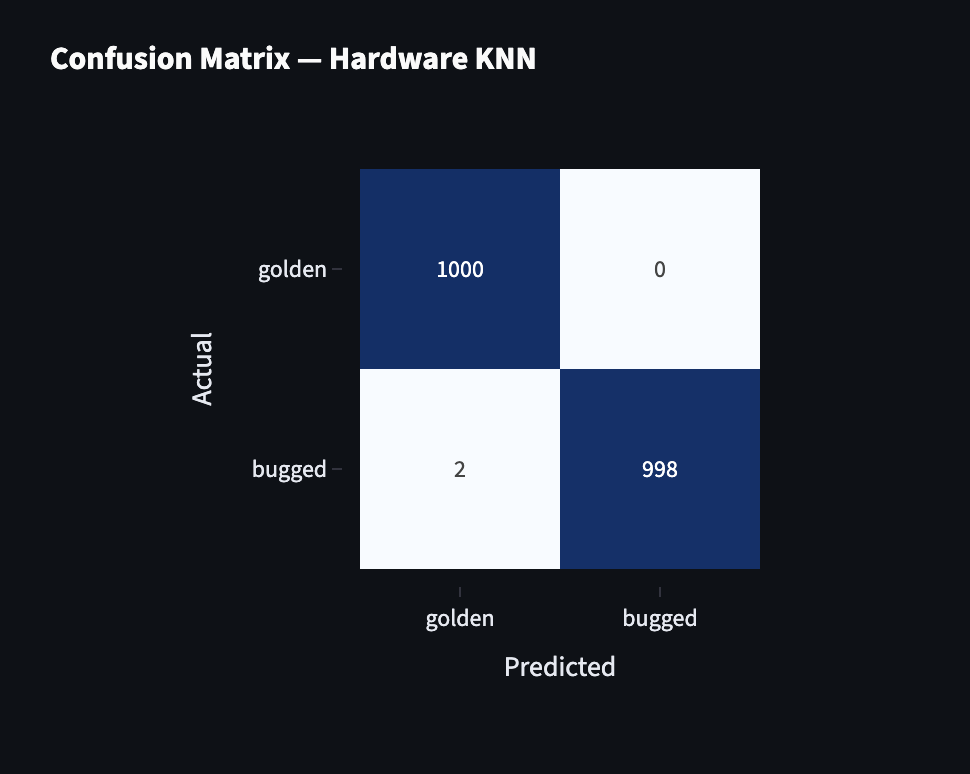

# TrojanShield (team project)

Trojan detection tool built by our team (Group 6) in three days at Aggie Invent, a Texas A&M design competition, in April 2026. We pitched it to the judges under the name Firmguard.

The problem we were given was dormant trojans: malicious code that stays quiet during normal testing and only activates under specific conditions. Static analysis tends to miss them because the payload is obfuscated, and testing every physical chip doesn't scale. Our approach was to run a file through several independent checks and flag it if any of them catches something the others don't.

## My role

I worked on the initial concept. One of my ideas was to also look for trojans in the hardware data the organizers gave us (power draw, timing, and jitter traces from clean and trojaned chips), since a trojan that switches on has to draw extra power or add delay somewhere, even if its code is well hidden. Most of the code here was written by my teammates.

The team turned that idea into a k-nearest-neighbors classifier, which correctly classified 1000 of 1000 clean chips and 998 of 1000 trojaned chips on the competition data. That code and the dashboard we demoed are in my teammate's repo, [Aggie-invent-demo](https://github.com/ANGELOREYES-afk/Aggie-invent-demo).



## How the scanner works

`trojanshield.py` runs a file through five scanners and combines their scores into a 0-100 threat score:

| Stage | What it looks for | Code |
|---|---|---|
| Static analysis | Entropy, suspicious imports, IOC strings, fuzzy hashes, PE header structure | `scanners/static.py` |
| Sandbox simulation | Anti-analysis tricks (CPUID and RDTSC probes), dormancy triggers, C2 beacons | `scanners/sandbox.py` |
| Heuristics | 17 rule signatures for injection, persistence, anti-debugging, and encoded payloads | `scanners/heuristic.py` |
| Multi-environment | Replays the sample against different fake environments to bait environment-aware malware | `scanners/multivm.py` |
| ML | Malware family classifier plus an anomaly detector for things that match no known family | `ml/` |

The scanners only read the file. Nothing is ever executed.

```
pip install -r requirements.txt
python samples/make_sample.py
python trojanshield.py samples/test_trojan.bin -o report.json
```

`make_sample.py` builds a harmless fake binary that contains common trojan strings (an encoded PowerShell command, a C2 URL, a CPUID check) so you can see what a detection looks like. `example_report.json` is the output for that sample. Add `--dashboard` for a live terminal view.

The full pitch deck is in [docs/Firmguard_AggieInvent_Pitch.pdf](docs/Firmguard_AggieInvent_Pitch.pdf). The competition's chip datasets belong to the organizers, so they are not included here.
